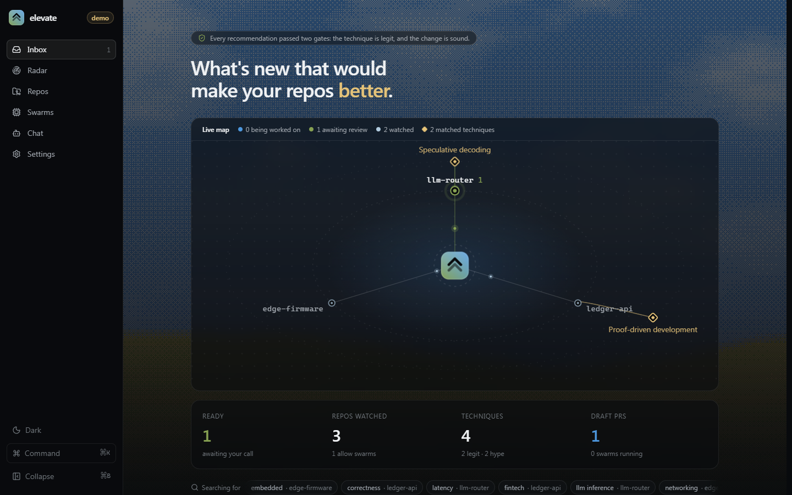
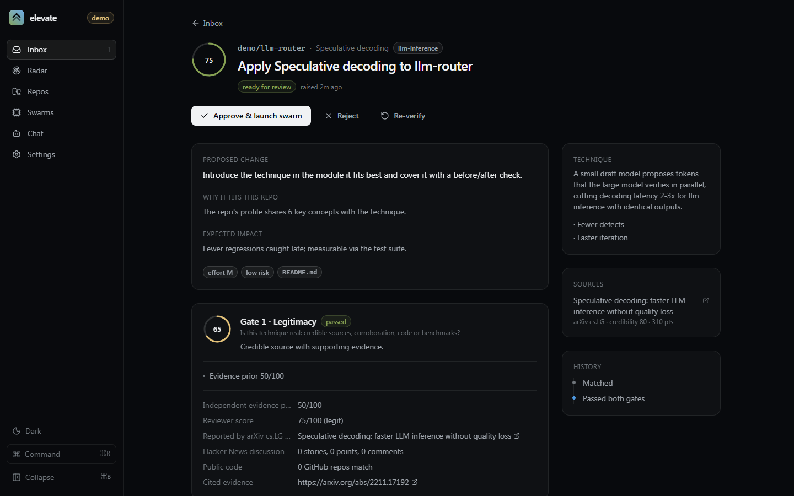
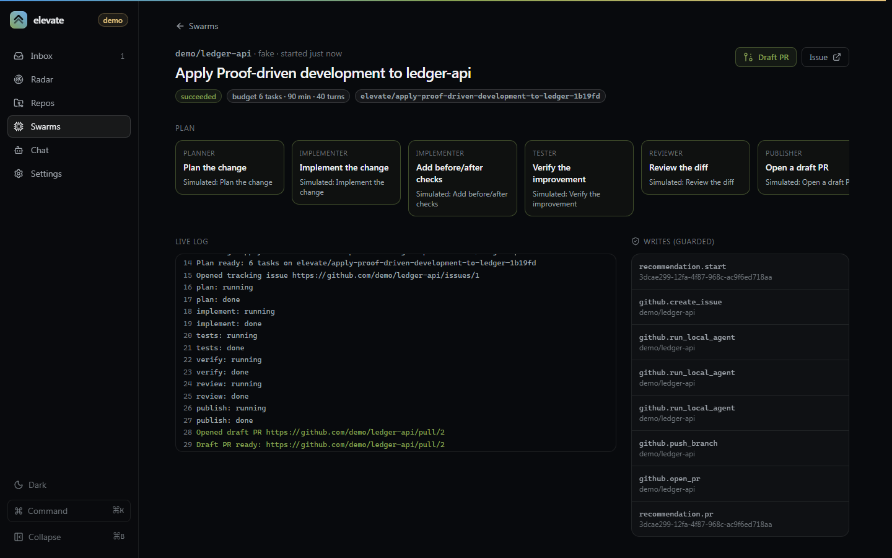
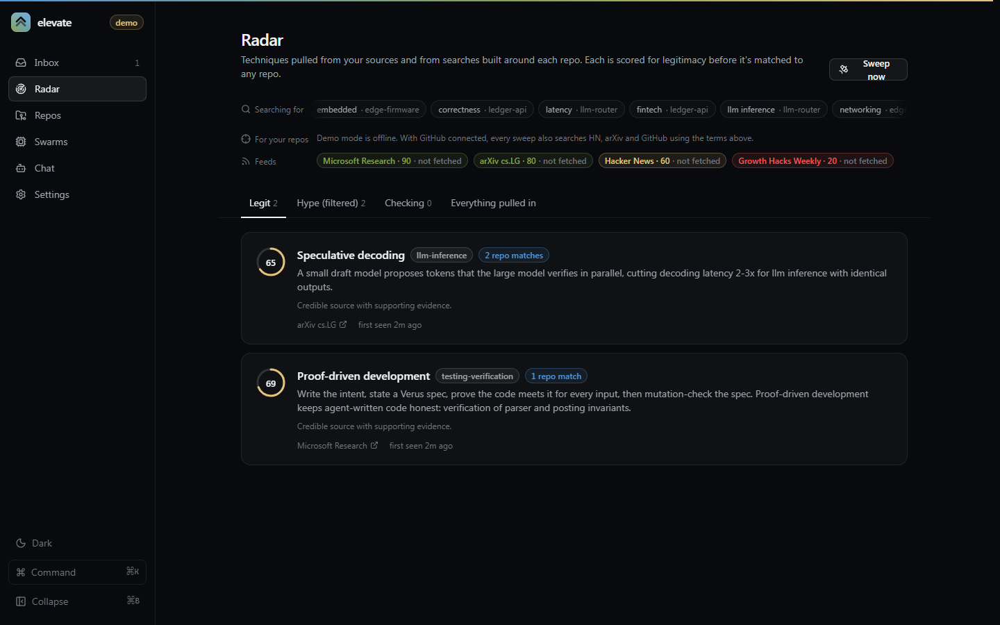
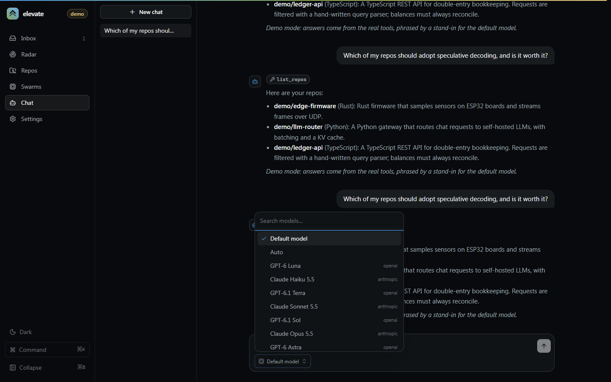

<p align="center">
  
</p>

<h1 align="center">elevate</h1>

<p align="center">
  <b>New techniques ship every week. elevate tells you which ones would actually make <i>your</i> repos better, proves the rules it follows, and opens the draft PR.</b>
</p>

<p align="center">
  <a href="https://github.com/Bakar404/elevate/actions/workflows/ci.yml"></a>
  <a href="https://bakar404.github.io/elevate/"></a>
  <a href="LICENSE"></a>
  <a href="https://github.com/Bakar404/elevate/stargazers"></a>
  
  
  <a href="CONTRIBUTING.md"></a>
</p>

<p align="center">
  <a href="https://bakar404.github.io/elevate/">Website</a> ·
  <a href="#quick-start">Quick start</a> ·
  <a href="#how-it-works">How it works</a> ·
  <a href="#built-proof-first">Proof</a> ·
  <a href="#built-with">Built with</a>
</p>

<picture>
  <source media="(prefers-color-scheme: light)" srcset="docs/images/home-light.png">
  
</picture>

## What it does

Proof-driven development, speculative decoding, weight-space editing, whatever lands next. elevate watches the sources you choose for you: news, research papers, AI lab blogs, or any feed you plug in. When something new would make one of your GitHub repos better, it raises a recommendation. It raises one only after checking two things:

1. **Is the new thing actually legit?** It checks source credibility, independent corroboration, community signal, public code, and gets a skeptical model review.
2. **Is the change sound for this repo, and will it make a measurable difference?** It checks fit with the repo, risk, and a concrete way to measure the impact.

You approve, and elevate sends a swarm of agents that plan, implement, test and review the change, then open a **draft** PR. It never merges.

By default the PR is yours: when the Copilot coding agent finishes, elevate squashes its work into one commit under your account, opens the draft PR as you and closes Copilot's PR. Turn off "Publish swarm PRs as me" in Settings to keep Copilot's PR as it is.

Repo profiles stay current: every few minutes elevate checks each watched repo, and when the default branch has a new commit it re-profiles the repo at that commit and re-matches it against known techniques.

Pip, a small lookout in the sidebar, dozes when nothing is waiting, perks up when a recommendation is ready and gets busy while a swarm runs. Click it for a one-line status, or hide it from its bubble or ⌘K.

It works on your phone too: below 768px the sidebar becomes a bottom tab bar, chat history opens in a drawer, and every page fits the screen with no sideways scrolling.

The model runtime is the [GitHub Copilot SDK](https://github.com/github/copilot-sdk), so it runs on your Copilot subscription. You can bring your own key for Anthropic, OpenAI or Azure models. Swarms can run on:

- the Copilot coding agent
- Claude (GitHub Action)
- Codex cloud
- local `copilot` / `claude` / `codex` CLIs in git worktrees

<table>
  <tr>
    <td width="50%">
      <picture>
        <source media="(prefers-color-scheme: light)" srcset="docs/images/recommendation-light.png">
        
      </picture>
      <p align="center"><sub><b>Recommendation.</b> Evidence for both gates, the expected impact, and how it will be measured.</sub></p>
    </td>
    <td width="50%">
      <picture>
        <source media="(prefers-color-scheme: light)" srcset="docs/images/swarm-light.png">
        
      </picture>
      <p align="center"><sub><b>Swarm.</b> Live task graph, budget and audit trail, ending in a draft PR.</sub></p>
    </td>
  </tr>
  <tr>
    <td width="50%">
      <picture>
        <source media="(prefers-color-scheme: light)" srcset="docs/images/radar-light.png">
        
      </picture>
      <p align="center"><sub><b>Radar.</b> Every technique seen, with its gate verdict and the repos it matched.</sub></p>
    </td>
    <td width="50%">
      <picture>
        <source media="(prefers-color-scheme: light)" srcset="docs/images/chat-light.png">
        
      </picture>
      <p align="center"><sub><b>Chat.</b> Ask about your repos and the radar. Pick the model for each conversation.</sub></p>
    </td>
  </tr>
</table>

<sub>Screenshots use the built-in demo repos (<code>demo/ledger-api</code>, <code>demo/llm-router</code>, <code>demo/edge-firmware</code>). The app has a dark theme and a light theme. It follows your system setting until you pick one with the sun/moon button or ⌘K.</sub>

## Quick start

```sh
pnpm install
cp .env.example .env            # optional; everything has a default
pnpm dev                        # http://localhost:3100
```

- **Real mode:**
  - Sign in to GitHub with `gh auth login`, or paste a token in Settings. The model runs through your Copilot login.
  - Turn on **Watch** for your repos, and **Swarms** for the ones elevate may write to.
- **Offline demo:** `ELEVATE_DEMO=1 pnpm dev` uses sample repos and sources, a deterministic model and simulated swarms. It doesn't touch GitHub.
- **Docker:** `docker compose up -d --build` runs Postgres, the web app and a separate worker at http://localhost:3100. They restart on their own (`restart: unless-stopped`), so with Docker Desktop set to start at sign-in, elevate is back after every reboot. `docker compose stop` turns it off.
- **Check the model runtime:** `pnpm smoke:copilot` makes one structured call through Copilot, or through your BYOK provider.

## How it works

<picture>
  <source media="(prefers-color-scheme: light)" srcset="docs/images/pipeline-light.svg">
  
</picture>

Sources come in two kinds:

- **Feeds** are the same for everyone. They start with the HN front page, AI lab blogs and arXiv listings, and any other source can be added as a connector.
- **Searches for your repos** query HN, arXiv and GitHub with terms taken from each watched repo's profile: its stack and domains, such as `pgvector` or `speculative decoding`.
  - Every repo gets at least one query before shared terms fill the budget (`ELEVATE_FOCUS_QUERIES`, default 8).
  - Anything found that way is matched to those repos first.

Techniques that fail a gate are kept, but hidden, along with the reasons they failed.

### News that fits your setup

elevate only raises what you can act on. It works out what you have from your connection, and Settings → **What you can use** lets you switch products on or off yourself.

| You connect | You hear about |
|---|---|
| GitHub Copilot | Copilot itself, and the model vendors on your plan's live model list |
| Anthropic key | Claude models and Claude Code |
| OpenAI key | GPT models and Codex |
| Azure OpenAI | GPT models |

Anything else is set aside before it costs a gate review, and listed with the reason under Radar → **Not for your setup**:

- **Not connected.** The technique needs a product you don't have, such as Codex news for a Claude-only setup. Product feeds (Claude Code, Codex and Copilot CLI releases, OpenAI News) aren't even fetched.
- **Outdated.** It is about a model version that has been replaced. What counts as current comes from your plan's model list and from the versions seen in incoming news, not from a list in the code, so it keeps up on its own.
- **Not on your plan.** With Copilot, it names a model your plan doesn't list.
- **Too old.** Feeds return their whole archive, so items published more than `ELEVATE_MAX_ITEM_AGE_DAYS` (default 60) ago are skipped.

Switching a product on later sends what was held for it through the gates. Sources can be switched off, and your own RSS or Atom feeds added, from Radar → **Manage sources**.

An approved recommendation becomes a task graph:

<picture>
  <source media="(prefers-color-scheme: light)" srcset="docs/images/swarm-light.svg">
  
</picture>

See [docs/architecture.md](docs/architecture.md) for the packages, jobs and data model, and [docs/design.md](docs/design.md) for the UI.

## Models

Settings has two model pickers: one for the background agents (triage, the gates, swarm planning) and a default for chat. Each conversation can also choose its own model in the chat composer. Conversations can be deleted from the chat list.

The model list comes live from your Copilot account, so it shows exactly what your plan allows; models your plan disables are greyed out. With a BYOK provider, you type the model id.

## Built proof-first

The rules that stand between a headline and a branch on your repo are **proved**, not just tested:

- the Gate 1 and Gate 2 decisions
- the recommendation lifecycle: no swarm without both gates and your approval
- the write guard: never merge, only opted-in repos, drafts only, within budget

<picture>
  <source media="(prefers-color-scheme: light)" srcset="docs/images/proof-light.svg">
  
</picture>

They follow the [PDD Kit](https://www.microsoft.com/en-us/research/blog/formally-verifying-agent-written-full-stack-web-apps-with-pdd-kit/) method:

1. **Intent:** [`proof/intent.md`](proof/intent.md) states 26 requirements in plain words.
2. **Spec and proof:** [`proof/verified/src/lib.rs`](proof/verified/src/lib.rs) states each requirement in Verus and proves it for every input.
3. **Mutation check:** one bug is planted per clause, and Verus must reject each one.
4. **Differential test:** the TypeScript the app runs (`packages/policy`) is compared with the proved code, built to WASM, over every input class. A **negative control** shows the test can fail.
5. **Receipt:** [`proof/RECEIPT.md`](proof/RECEIPT.md), which is also shown on the Settings page.

A proof can't cover the quality of the model's judgments, so the gate eval set measures that. `pnpm eval:gates` runs the reference reviews, and `pnpm eval:gates --live` asks your model for the Gate 1 reviews. The cases are in [`fixtures/gate-eval.json`](fixtures/gate-eval.json).

<picture>
  <source media="(prefers-color-scheme: light)" srcset="docs/images/evals-light.svg">
  
</picture>

Last live run, on the Copilot default model:

- **Gate 1** had a precision of 1.00 and a recall of 0.89, and passed 0 of the 7 hype cases. Its only miss was a deliberately borderline "fresh preprint".
- **Gate 2** judged 7 of 7 cases correctly. It is scored on the reference reviews, because `--live` replaces only the Gate 1 reviews.
- 3 of 16 reviews contradicted themselves and were asked again. See `consistentReview` in [docs/architecture.md](docs/architecture.md).

## Commands

| Command | What it does |
|---|---|
| `pnpm dev` | Web app with the embedded worker on :3100 |
| `pnpm worker` | Standalone worker (set `ELEVATE_EMBEDDED_WORKER=0` on the web app and use Postgres) |
| `pnpm test` | Unit and integration tests (vitest) |
| `pnpm test:e2e` | Playwright end-to-end run against the demo |
| `pnpm typecheck` | Type-check every package |
| `pnpm eval:gates [--live]` | Gate precision and recall on the eval set, plus a threshold sweep |
| `pnpm smoke:copilot` | One live call through the Copilot SDK or BYOK provider |
| `pnpm proof` | Re-run the proof, mutation check, WASM build, differential test and negative control, then rewrite the receipt (needs Verus) |
| `node scripts/diagrams.mjs` | Regenerate the README and website diagrams in both themes |
| `pnpm --filter @elevate/web exec node ../../scripts/phone-shots.mjs` | Regenerate the website's phone screenshots from a running demo |

## Storage

Local mode uses embedded PGlite (Postgres in WASM) with pgvector, stored in `.data/`. To use a real Postgres instead, set `DATABASE_URL`; `docker compose up db` starts one.

Every table has a `tenant_id`, so the data model is ready for multi-tenant SaaS. Tokens and API keys are encrypted at rest with AES-GCM. The key comes from `ELEVATE_SECRET`, or from `.data/secret.key`.

In Docker, put `GITHUB_TOKEN` (and any BYOK key) in `.env`, because a container has no `gh` login to fall back on. If registry.npmjs.org is blocked on your network, point the image build at a mirror: `NPM_REGISTRY=https://your-mirror/npm/ docker compose build`.

## Safety rails

- Nothing is written to GitHub until you approve, and only to repos you opted in.
- Pull requests are drafts. elevate never merges, pushes to a default branch, or force-pushes.
- Every swarm has a budget for tasks, minutes and agent turns. Swarms still running when the worker restarts are resumed, not re-planned.
- The only PR elevate closes is the coding agent's own PR after republishing it as you, and only while that swarm is running.
- Every write is checked by the proved guard and recorded in the audit log.

## Built with

**Design.** The interface borrows patterns and components from these libraries and showcases:

| | |
|---|---|
| [Aceternity UI](https://ui.aceternity.com/) | Spotlight cards and hero background effects |
| [21st.dev](https://21st.dev/) | Community React components used as reference for the inbox and cards |
| [shadcn/ui](https://ui.shadcn.com/) | Component structure, tokens and the overall look |
| [Base UI](https://base-ui.com/) | Unstyled, accessible primitives under the components |
| [Sonner](https://sonner.emilkowal.ski/) | Toasts, themed to match light and dark |
| [cmdk](https://github.com/dip/cmdk) | The ⌘K command palette |
| [NumberFlow](https://number-flow.barvian.me/) | Animated scores, counters and budgets |
| [emilkowalski/skills](https://github.com/emilkowalski/skills) | Motion and interaction guidelines |
| [Beautiful UI](https://www.beautifului.dev/) | Layout and typography reference |
| [RareUI](https://rareui.in/) | Animated accents reference |
| [CUI](https://yappologistic.github.io/CUI/) | Inspiration for the dithered background and the website layout |

**Stack.**

- **Framework:** [Next.js](https://nextjs.org/), [React](https://react.dev/), [TypeScript](https://www.typescriptlang.org/)
- **UI:** [Tailwind CSS v4](https://tailwindcss.com/), [Motion](https://motion.dev/), [Lucide](https://lucide.dev/) icons, [react-markdown](https://github.com/remarkjs/react-markdown)
- **Agents:** [GitHub Copilot SDK](https://github.com/github/copilot-sdk)
- **Data:**
  - [Drizzle ORM](https://orm.drizzle.team/)
  - [PGlite](https://pglite.dev/) and [pgvector](https://github.com/pgvector/pgvector)
  - a Postgres job queue built in (`FOR UPDATE SKIP LOCKED`)
  - [Octokit](https://github.com/octokit/rest.js) for GitHub
- **Proof:**
  - [Verus](https://github.com/verus-lang/verus)
  - the [PDD Kit](https://www.microsoft.com/en-us/research/blog/formally-verifying-agent-written-full-stack-web-apps-with-pdd-kit/) method
- **Tests:** [Vitest](https://vitest.dev/), [Playwright](https://playwright.dev/)

## Contributing

New source connectors, executors and gate eval cases are the most useful contributions. See [CONTRIBUTING.md](CONTRIBUTING.md). Ask questions and share ideas in [Discussions](https://github.com/Bakar404/elevate/discussions), and [suggest a source](https://github.com/Bakar404/elevate/issues/new?template=new_source.yml) you think elevate should watch.

If elevate is useful to you, a ⭐ helps other people find it.

<a href="https://star-history.com/#Bakar404/elevate&Date">
  <picture>
    <source media="(prefers-color-scheme: dark)" srcset="https://api.star-history.com/svg?repos=Bakar404/elevate&type=Date&theme=dark">
    
  </picture>
</a>

## License

[MIT](LICENSE)
